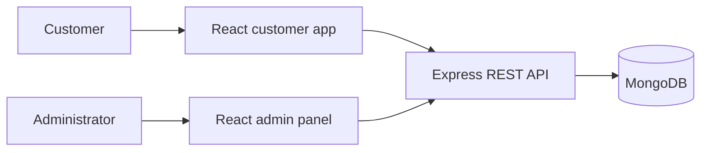

<div align="center">

# VirtuaCarz

### A full-stack car rental app with a customer experience and an admin fleet dashboard.

Browse cars, manage reservations, and keep the fleet up to date from one project.


</div>

---

## About

VirtuaCarz is a car rental web application made up of three parts:

- **Customer app** — browse the available cars, view vehicle details, make bookings, and manage a profile and reservations.
- **Admin panel** — add, edit, and remove cars; review bookings; and change booking status.
- **REST API** — handles users, cars, bookings, authentication, and MongoDB persistence.

## Features

### Customer app

- Browse the fleet and view individual car details.
- Register and sign in.
- Create bookings and review them from the profile page.
- Update profile information and request booking date changes.

### Admin panel

- Manage car listings, including optional image replacement.
- Review all bookings and filter by pending, confirmed, or cancelled status.
- View booking and customer details, then update booking status.

### Server

- JWT-based authentication and admin authorization middleware.
- MongoDB models for users, cars, and bookings.
- Image uploads processed through Multer and stored as Base64 data.

## Built with

| Area | Tools |
| --- | --- |
| Customer app | React, Vite, React Router, Redux Toolkit, Tailwind CSS |
| Admin panel | React, Vite, React Router, Redux Toolkit, Tailwind CSS |
| API | Node.js, Express, Mongoose, JWT, Multer |
| Database | MongoDB |

## Project structure

```text
Car_Rental/
├── client/          # Customer-facing React app
├── admin-panel/     # Admin React app
└── server/          # Express API and MongoDB models
```



## Getting started

### Prerequisites

- Node.js 20 or newer and npm.
- A MongoDB database, local or hosted.

### 1. Configure the server

Create `server/.env` (or copy `server/.env.example`):

```dotenv
PORT=8080
MONGO_URI=mongodb://127.0.0.1:27017/virtuacarz
JWT_SECRET=replace-with-a-long-random-secret
DEV_MODE=development
```

Use your own MongoDB connection string and a private JWT secret. Keep `.env` files out of commits.
Make sure the MongoDB server is running before starting the API.

Install dependencies and start the API:

```bash
cd server
npm install
npm start
```

The API runs at `http://localhost:8080` by default. Its base path is `/api/v1`.

### 2. Configure and start the customer app

Create `client/.env.local` (or copy `client/.env.example`). `VITE_BASEURL` is
optional — the Vite dev server proxies `/api` to the API on port `8080`:

```dotenv
VITE_BASEURL=http://localhost:8080/api/v1
```

Then run:

```bash
cd client
npm install
npm run dev
```

### 3. Configure and start the admin panel

Create `admin-panel/.env.local` (or copy `admin-panel/.env.example`) with the
same API URL. It is optional for the same reason as the customer app:

```dotenv
VITE_BASEURL=http://localhost:8080/api/v1
```

Then run:

```bash
cd admin-panel
npm install
npm run dev
```

Keep the server and each Vite app running in separate terminals. The customer
app uses `http://localhost:5173/` and the admin panel uses
`http://localhost:5174/admin/`. The customer dev server also proxies `/admin/`,
so both apps are available from one origin at `http://localhost:5173/` and
`http://localhost:5173/admin/`.

### Create an administrator

Register a user through the customer app first. New users have `isAdmin: false`. To use admin-only fleet and booking controls locally, set that account's `isAdmin` field to `true` in the MongoDB `users` collection.

Once promoted, sign in from the customer login page with the **Administrator**
option selected. The app opens the admin panel at `/admin/` and the shared
session carries across. Signed-in administrators also get an **Admin studio**
link in the account menu.

## API overview

All routes are prefixed with `/api/v1`.

| Method | Endpoint | Access | Purpose |
| --- | --- | --- | --- |
| `POST` | `/user/register` | Public | Create an account |
| `POST` | `/user/login` | Public | Sign in and receive a JWT |
| `PATCH` | `/user/update/:id` | Signed in | Update account details |
| `GET` | `/car/get-all` | Public | List cars |
| `GET` | `/car/:id` | Public | Get car details |
| `POST` | `/car/add-car` | Admin | Add a car |
| `PATCH` | `/car/update-car/:id` | Admin | Update a car |
| `DELETE` | `/car/delete-car/:id` | Admin | Delete a car |
| `POST` | `/booking/create` | Signed in | Create a booking |
| `GET` | `/booking/get-all` | Public | List bookings |
| `GET` | `/booking/get-details/:id` | Admin | Get booking details |
| `PATCH` | `/booking/update-status/:id` | Admin | Set status to `pending`, `confirm`, or `cancel` |
| `GET` | `/booking/user-booking/:id` | Signed in | List a user's bookings |
| `PATCH` | `/booking/update/:id` | Signed in | Change booking dates |

Admin-only routes require a valid JWT for an account with `isAdmin: true`.

## Scripts

Run these from the relevant app directory:

| Command | Description |
| --- | --- |
| `npm run dev` | Start the Vite development server (`client` or `admin-panel`) |
| `npm run build` | Create a production build (`client` or `admin-panel`) |
| `npm run lint` | Run ESLint (`client` or `admin-panel`) |
| `npm run preview` | Preview a production build (`client` or `admin-panel`) |
| `npm start` | Start the API (`server`) |

From the repository root, the wrapper scripts are:

| Command | Description |
| --- | --- |
| `npm run install:all` | Install `client`, `admin-panel`, and `server` dependencies |
| `npm run build` | Build both frontends |
| `npm start` | Start the API, which also serves both frontend builds |

## Deploy as a single service

The API can serve the customer app, the admin panel, and the REST API from one
origin:

```text
/            → client/dist
/admin/      → admin-panel/dist
/api/v1      → Express API
/api/health  → health check
```

Build both frontends and start the server:

```bash
npm run install:all
npm run build
npm start
```

Open `http://localhost:8080/`; the admin panel is at
`http://localhost:8080/admin/`.

### Deploying to Render

1. Create a MongoDB Atlas cluster (M0 is enough), add a database user, and copy
   the SRV connection string. Add `/virtuacarz` before the `?`. Allow
   connections from Render (`0.0.0.0/0` on the free plan).
2. In Render, create a **Web Service** from this repository and leave the root
   directory at the repository root.
3. Set the build command to `npm run install:all && npm run build`, the start
   command to `npm start`, and the health check path to `/api/health`.
4. Add these environment variables:

   | Variable | Value |
   | --- | --- |
   | `MONGO_URI` | Atlas SRV connection string |
   | `JWT_SECRET` | A long random string (`openssl rand -hex 32`) |
   | `DEV_MODE` | `production` |
   | `NODE_VERSION` | `24` |

   Do not set `PORT`; Render provides it.
5. Deploy, then open `https://<service>.onrender.com/`. The admin panel is at
   `/admin/`.

The production frontends fall back to `/api/v1` on their own origin, so
`VITE_BASEURL` is not required. If you set it, use a URL reachable from the
browser.

> Render's free instance sleeps after inactivity, so the first request after a
> quiet period can take 30–60 seconds. Use a paid instance if you need it
> always-on.

The same build and start commands work on Railway and Fly.io. For a VPS, run
`npm start` behind Caddy or nginx and proxy port `8080`. Set `HOST=127.0.0.1`
if the proxy runs on the same machine.

## Notes

- The frontends read `VITE_BASEURL` at build/dev time. Restart Vite after changing `.env.local`. Leave it unset to use the same-origin `/api/v1` fallback.
- The admin panel is served under `/admin/` in development (through the customer Vite proxy) and in production.
- The API uses `MONGO_URI` and `JWT_SECRET` from `server/.env`.
- The server binds to `0.0.0.0` by default; set `HOST` to restrict it.
- Car images are stored as Base64 strings in MongoDB, so consider the database size implications when adding large images.

## Contributing

1. Fork the repository and create a focused branch.
2. Make a change in the customer app, admin panel, or API.
3. Run the relevant app's lint/build scripts before opening a pull request.
4. Describe the change and include screenshots for visual updates.

---

<div align="center">

Made with care for easier car rentals.

</div>
