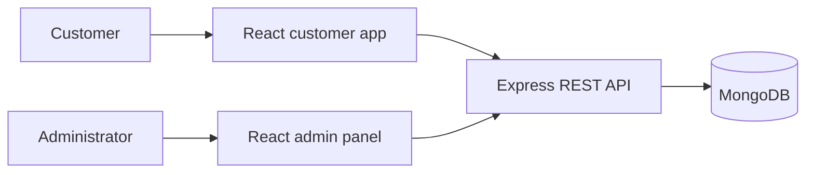

<div align="center">

# VirtuaCarz

### A full-stack car rental app with a customer experience and an admin fleet dashboard.

Browse cars, manage reservations, and keep the fleet up to date from one project.


</div>

---

## About

VirtuaCarz is a car rental web application made up of three parts:

- **Customer app** — browse the available cars, view vehicle details, make bookings, and manage a profile and reservations.
- **Admin panel** — add, edit, and remove cars; review bookings; and change booking status.
- **REST API** — handles users, cars, bookings, authentication, and MongoDB persistence.

## Features

### Customer app

- Browse the fleet and view individual car details.
- Register and sign in.
- Create bookings and review them from the profile page.
- Update profile information and request booking date changes.

### Admin panel

- Manage car listings, including optional image replacement.
- Review all bookings and filter by pending, confirmed, or cancelled status.
- View booking and customer details, then update booking status.

### Server

- JWT-based authentication and admin authorization middleware.
- MongoDB models for users, cars, and bookings.
- Image uploads processed through Multer and stored as Base64 data.

## Built with

| Area | Tools |
| --- | --- |
| Customer app | React, Vite, React Router, Redux Toolkit, Tailwind CSS |
| Admin panel | React, Vite, React Router, Redux Toolkit, Tailwind CSS |
| API | Node.js, Express, Mongoose, JWT, Multer |
| Database | MongoDB |

## Project structure

```text
Car_Rental/
├── client/          # Customer-facing React app
├── admin-panel/     # Admin React app
└── server/          # Express API and MongoDB models
```



## Getting started

### Prerequisites

- Node.js 20 or newer and npm.
- A MongoDB database, local or hosted.

### 1. Configure the server

Create `server/.env` (or copy `server/.env.example`):

```dotenv
PORT=8080
MONGO_URI=mongodb://127.0.0.1:27017/virtuacarz
JWT_SECRET=replace-with-a-long-random-secret
DEV_MODE=development
```

Use your own MongoDB connection string and a private JWT secret. Keep `.env` files out of commits.
Make sure the MongoDB server is running before starting the API.

Install dependencies and start the API:

```bash
cd server
npm install
npm start
```

The API runs at `http://localhost:8080` by default. Its base path is `/api/v1`.

### 2. Configure and start the customer app

Create `client/.env.local` (or copy `client/.env.example`). `VITE_BASEURL` is
optional — the Vite dev server proxies `/api` to the API on port `8080`:

```dotenv
VITE_BASEURL=http://localhost:8080/api/v1
```

Then run:

```bash
cd client
npm install
npm run dev
```

### 3. Configure and start the admin panel

Create `admin-panel/.env.local` (or copy `admin-panel/.env.example`) with the
same API URL. It is optional for the same reason as the customer app:

```dotenv
VITE_BASEURL=http://localhost:8080/api/v1
```

Then run:

```bash
cd admin-panel
npm install
npm run dev
```

Keep the server and each Vite app running in separate terminals. The customer
app uses `http://localhost:5173/` and the admin panel uses
`http://localhost:5174/admin/`. The customer dev server also proxies `/admin/`,
so both apps are available from one origin at `http://localhost:5173/` and
`http://localhost:5173/admin/`.

### Create an administrator

Register a user through the customer app first. New users have `isAdmin: false`. To use admin-only fleet and booking controls locally, set that account's `isAdmin` field to `true` in the MongoDB `users` collection.

Once promoted, sign in from the customer login page with the **Administrator**
option selected. The app opens the admin panel at `/admin/` and the shared
session carries across. Signed-in administrators also get an **Admin studio**
link in the account menu.

## API overview

All routes are prefixed with `/api/v1`.

| Method | Endpoint | Access | Purpose |
| --- | --- | --- | --- |
| `POST` | `/user/register` | Public | Create an account |
| `POST` | `/user/login` | Public | Sign in and receive a JWT |
| `PATCH` | `/user/update/:id` | Signed in | Update account details |
| `GET` | `/car/get-all` | Public | List cars |
| `GET` | `/car/:id` | Public | Get car details |
| `POST` | `/car/add-car` | Admin | Add a car |
| `PATCH` | `/car/update-car/:id` | Admin | Update a car |
| `DELETE` | `/car/delete-car/:id` | Admin | Delete a car |
| `POST` | `/booking/create` | Signed in | Create a booking |
| `GET` | `/booking/get-all` | Public | List bookings |
| `GET` | `/booking/get-details/:id` | Admin | Get booking details |
| `PATCH` | `/booking/update-status/:id` | Admin | Set status to `pending`, `confirm`, or `cancel` |
| `GET` | `/booking/user-booking/:id` | Signed in | List a user's bookings |
| `PATCH` | `/booking/update/:id` | Signed in | Change booking dates |

Admin-only routes require a valid JWT for an account with `isAdmin: true`.

## Scripts

Run these from the relevant app directory:

| Command | Description |
| --- | --- |
| `npm run dev` | Start the Vite development server (`client` or `admin-panel`) |
| `npm run build` | Create a production build (`client` or `admin-panel`) |
| `npm run lint` | Run ESLint (`client` or `admin-panel`) |
| `npm run preview` | Preview a production build (`client` or `admin-panel`) |
| `npm start` | Start the API (`server`) |

From the repository root, the wrapper scripts are:

| Command | Description |
| --- | --- |
| `npm run install:all` | Install `client`, `admin-panel`, and `server` dependencies |
| `npm run build` | Build both frontends |
| `npm start` | Start the API, which also serves both frontend builds |

## Deploy as a single service

The API can serve the customer app, the admin panel, and the REST API from one
origin:

```text
/            → client/dist
/admin/      → admin-panel/dist
/api/v1      → Express API
/api/health  → health check
```

Build both frontends and start the server:

```bash
npm run install:all
npm run build
npm start
```

Open `http://localhost:8080/`; the admin panel is at
`http://localhost:8080/admin/`.

### Run with Docker

The repository includes a multi-stage `Dockerfile` that builds both frontends
and runs them with production-only server dependencies. `.dockerignore` keeps
`node_modules`, build output, and every `.env` file out of the image.

Build and run it:

```bash
docker build -t virtuacarz .
docker run --rm -p 8080:8080 \
  --env-file server/.env \
  -e PORT=8080 \
  -e HOST=0.0.0.0 \
  virtuacarz
```

Open `http://localhost:8080/`; the admin panel is at
`http://localhost:8080/admin/`.

If port `8080` is already in use on your machine, publish a different port:

```bash
docker run --rm -p 8081:8080 --env-file server/.env \
  -e PORT=8080 -e HOST=0.0.0.0 virtuacarz
```

Then open `http://localhost:8081/`.

If the build fails while downloading packages with `EAI_AGAIN` or a registry
timeout, rebuild using the host's network and DNS:

```bash
docker build --network=host -t virtuacarz .
```

`npm ci` is configured with extra retries, but `--network=host` is the quickest
fix when Docker's embedded DNS cannot reach the registry.

`--env-file` passes configuration at runtime; nothing from `server/.env` is
baked into the image. The container needs a MongoDB host it can reach. If
`MONGO_URI` contains `127.0.0.1`, the container will look for MongoDB inside
itself — use an Atlas URI instead, or `host.docker.internal` when the database
runs on the Docker host.

### Deploy to Render with Docker

#### Option A — Render Blueprint (recommended)

`render.yaml` in the repository root defines the whole service:

- Runtime: Docker, using `./Dockerfile`
- Plan: `free` ($0, no card required; sleeps after 15 minutes of inactivity)
- Health check: `/api/health`
- `JWT_SECRET`: generated automatically by Render
- `MONGO_URI`: prompted for when the Blueprint is created

1. Push this repository to GitHub, GitLab, or Bitbucket.
2. In Render, click **New > Blueprint** and connect the repository.
3. Choose the branch you want to deploy (usually `main` or `master`).
4. When Render asks for `MONGO_URI`, paste the MongoDB Atlas SRV connection
   string with `/virtuacarz` before the `?` query parameters.
5. Click **Apply**. Render builds the image and deploys the service.

When the deploy finishes, open `https://<service-name>.onrender.com/`; the admin
panel is at `/admin/`.

#### Option B — Create the web service manually

1. Click **New > Web Service**, connect the repository, and leave **Root
   Directory** empty.
2. Set **Language** to **Docker**.
3. Set **Dockerfile Path** to `./Dockerfile` and **Docker Build Context** to `.`.
4. Choose the **Free** plan ($0, no card required). It spins down after 15
   minutes of inactivity. Upgrade to **0.5c-512mb** ($7/month, always on) if
   you want to use Render credits.
5. Set **Health Check Path** to `/api/health`.
6. Add these environment variables:

   | Variable | Value |
   | --- | --- |
   | `MONGO_URI` | Atlas SRV connection string (include `/virtuacarz`) |
   | `JWT_SECRET` | Output of `openssl rand -hex 32` |
   | `DEV_MODE` | `production` |
   | `HOST` | `0.0.0.0` (optional; already the image default) |

   Do not set `PORT`. Render supplies it at runtime (10000 by default), and
   the server reads it automatically. The Dockerfile's `8080` default is only
   for standalone `docker run`.
7. Click **Create Web Service** and wait for the first deploy.

#### MongoDB Atlas

1. Create a free **M0** cluster, add a database user, and copy the SRV
   connection string.
2. Under **Network Access**, allow `0.0.0.0/0` if you are on the free plan.
   Render's outbound IPs are not static, so an allowlist is not practical
   without a paid egress option.
3. Add `/virtuacarz` before the `?` in the URI and use it as `MONGO_URI`.

The production frontends fall back to `/api/v1` on their own origin, so
`VITE_BASEURL` is not required. If you set it, use a URL reachable from the
browser.

### Using your $50 Render credits

The Blueprint is configured for the **Free** plan so it works without a credit
card. Your credits stay available if you later upgrade the service to a paid
plan.

1. Open the Render Dashboard in the **workspace** that will own the service.
2. Go to **Billing → Credit Balance**, enter the promo code, and click
   **Apply**. If the credits were granted automatically, the balance already
   appears there.
3. Credits are **workspace-specific** and cannot be transferred to another
   workspace. Redeem them in the workspace where you create the service.
4. Render does **not** spend credits in real time. At the end of each monthly
   billing period it calculates the workspace bill and deducts that amount
   from the credit balance. Any remainder is charged to the payment method on
   file. Credits do not cover charges from previous months.
5. Adding credits does not upgrade the workspace or the service. `render.yaml`
   currently selects `free`; change it to `0.5c-512mb` to use credits.
6. Promo credits can expire. Check the **Billing** page or the terms of the
   promotion you received.

Cost with this setup:

| Item | Cost |
| --- | --- |
| Free web service | $0/month, sleeps after 15 minutes idle |
| `0.5c-512mb` upgrade | $7/month, always on |
| Hobby workspace | $0/month |
| Included bandwidth | 5 GB/month, then $0.15/GB |
| Included pipeline minutes | 500/month, then $5 per 1,000 |
| `1c-2g` upgrade (optional) | $25/month |

The Blueprint currently uses the Free plan, so it does not consume credits. If
you upgrade to `0.5c-512mb`, $50 of credits covers roughly **7 months** with no
extra bandwidth or build charges. On the $25/month plan it would last about two
months. The Free plan spins down after 15 minutes of inactivity and takes about
a minute to wake up.

> Render can require a payment method on file to create a paid service even
> when credits will cover the bill; the credits are applied to the invoice at
> the end of the billing period.

## Notes

- The frontends read `VITE_BASEURL` at build/dev time. Restart Vite after changing `.env.local`. Leave it unset to use the same-origin `/api/v1` fallback.
- The admin panel is served under `/admin/` in development (through the customer Vite proxy) and in production.
- The API uses `MONGO_URI` and `JWT_SECRET` from `server/.env`.
- The server binds to `0.0.0.0` by default; set `HOST` to restrict it.
- Car images are stored as Base64 strings in MongoDB, so consider the database size implications when adding large images.

## Contributing

1. Fork the repository and create a focused branch.
2. Make a change in the customer app, admin panel, or API.
3. Run the relevant app's lint/build scripts before opening a pull request.
4. Describe the change and include screenshots for visual updates.

---

<div align="center">

Made with care for easier car rentals.

</div>
