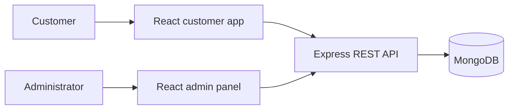

<div align="center">

# VirtuaCarz

### A full-stack car rental app with a customer experience and an admin fleet dashboard.

Browse cars, manage reservations, and keep the fleet up to date from one project.


</div>

---

## About

VirtuaCarz is a car rental web application made up of three parts:

- **Customer app** — browse the available cars, view vehicle details, make bookings, and manage a profile and reservations.
- **Admin panel** — add, edit, and remove cars; review bookings; and change booking status.
- **REST API** — handles users, cars, bookings, authentication, and MongoDB persistence.

## Features

### Customer app

- Browse the fleet and view individual car details.
- Register and sign in.
- Create bookings and review them from the profile page.
- Update profile information and request booking date changes.

### Admin panel

- Manage car listings, including optional image replacement.
- Review all bookings and filter by pending, confirmed, or cancelled status.
- View booking and customer details, then update booking status.

### Server

- JWT-based authentication and admin authorization middleware.
- MongoDB models for users, cars, and bookings.
- Image uploads processed through Multer and stored as Base64 data.

## Built with

| Area | Tools |
| --- | --- |
| Customer app | React, Vite, React Router, Redux Toolkit, Tailwind CSS |
| Admin panel | React, Vite, React Router, Redux Toolkit, Tailwind CSS |
| API | Node.js, Express, Mongoose, JWT, Multer |
| Database | MongoDB |

## Project structure

```text
Car_Rental/
├── client/          # Customer-facing React app
├── admin-panel/     # Admin React app
└── server/          # Express API and MongoDB models
```



## Getting started

### Prerequisites

- Node.js 20 or newer and npm.
- A MongoDB database, local or hosted.

### 1. Configure the server

Create `server/.env`:

```dotenv
PORT=8080
MONGO_URI=mongodb://127.0.0.1:27017/virtuacarz
JWT_SECRET=replace-with-a-long-random-secret
DEV_MODE=development
```

Use your own MongoDB connection string and a private JWT secret. Keep `.env` files out of commits.

Install dependencies and start the API:

```bash
cd server
npm install
npm start
```

The API runs at `http://localhost:8080` by default. Its base path is `/api/v1`.

### 2. Configure and start the customer app

Create `client/.env.local`:

```dotenv
VITE_BASEURL=http://localhost:8080/api/v1
```

Then run:

```bash
cd client
npm install
npm run dev
```

### 3. Configure and start the admin panel

Create `admin-panel/.env.local` with the same API URL:

```dotenv
VITE_BASEURL=http://localhost:8080/api/v1
```

Then run:

```bash
cd admin-panel
npm install
npm run dev
```

Keep the server and each Vite app running in separate terminals. Vite prints the local URL for each app; if the customer app already uses port `5173`, Vite will select another available port for the admin panel.

### Create an administrator

Register a user through the customer app first. New users have `isAdmin: false`. To use admin-only fleet and booking controls locally, set that account's `isAdmin` field to `true` in the MongoDB `users` collection, then sign in to the admin panel with that account.

## API overview

All routes are prefixed with `/api/v1`.

| Method | Endpoint | Access | Purpose |
| --- | --- | --- | --- |
| `POST` | `/user/register` | Public | Create an account |
| `POST` | `/user/login` | Public | Sign in and receive a JWT |
| `PATCH` | `/user/update/:id` | Signed in | Update account details |
| `GET` | `/car/get-all` | Public | List cars |
| `GET` | `/car/:id` | Public | Get car details |
| `POST` | `/car/add-car` | Admin | Add a car |
| `PATCH` | `/car/update-car/:id` | Admin | Update a car |
| `DELETE` | `/car/delete-car/:id` | Admin | Delete a car |
| `POST` | `/booking/create` | Signed in | Create a booking |
| `GET` | `/booking/get-all` | Public | List bookings |
| `GET` | `/booking/get-details/:id` | Admin | Get booking details |
| `PATCH` | `/booking/update-status/:id` | Admin | Set status to `pending`, `confirm`, or `cancel` |
| `GET` | `/booking/user-booking/:id` | Signed in | List a user's bookings |
| `PATCH` | `/booking/update/:id` | Signed in | Change booking dates |

Admin-only routes require a valid JWT for an account with `isAdmin: true`.

## Scripts

Run these from the relevant app directory:

| Command | Description |
| --- | --- |
| `npm run dev` | Start the Vite development server (`client` or `admin-panel`) |
| `npm run build` | Create a production build (`client` or `admin-panel`) |
| `npm run lint` | Run ESLint (`client` or `admin-panel`) |
| `npm run preview` | Preview a production build (`client` or `admin-panel`) |
| `npm start` | Start the API (`server`) |

## Notes

- The frontends read `VITE_BASEURL` at build/dev time. Restart Vite after changing `.env.local`.
- The API uses `MONGO_URI` and `JWT_SECRET` from `server/.env`.
- Car images are stored as Base64 strings in MongoDB, so consider the database size implications when adding large images.

## Contributing

1. Fork the repository and create a focused branch.
2. Make a change in the customer app, admin panel, or API.
3. Run the relevant app's lint/build scripts before opening a pull request.
4. Describe the change and include screenshots for visual updates.

---

<div align="center">

Made with care for easier car rentals.

</div>
